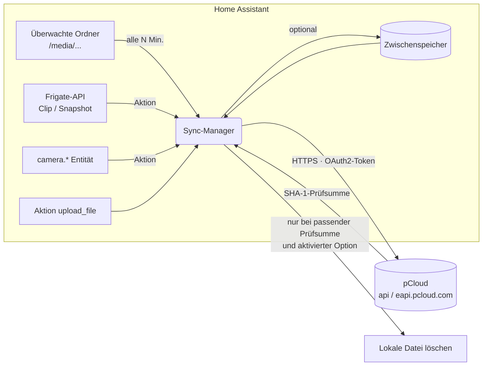

<div align="center">

# ☁️ pCloud Sync (Unofficial)

**Daten aus Home Assistant – Frigate-Clips, Kamera-Snapshots, Exporte, beliebige Dateien – direkt in dein pCloud-Laufwerk hochladen.**

[](https://my.home-assistant.io/redirect/marketplace_repository/?owner=DASO203&repository=pcloud-sync-unofficial&category=integration)
[](https://github.com/DASO203/pcloud-sync-unofficial/releases)
[](LICENSE)

[🇬🇧 English](README.md) · 🇩🇪 Deutsch

</div>

> [!IMPORTANT]
> Dies ist ein **Community-Projekt**. Es steht in keiner Verbindung zur pCloud AG und wird von ihr weder unterstützt noch empfohlen.

---

## Inhalt

- [Funktionen](#funktionen)
- [So funktioniert es](#so-funktioniert-es)
- [Voraussetzungen](#voraussetzungen)
- [Installation](#installation)
- [Einrichtung](#einrichtung)
- [Optionen](#optionen)
- [Datenquellen & Beispiele](#datenquellen--beispiele)
- [Aktionen (Dienste)](#aktionen-dienste)
- [Entitäten](#entitäten)
- [Events](#events)
- [Sicherheit & Transparenz](#sicherheit--transparenz)
- [Fehlerbehebung](#fehlerbehebung)
- [Deinstallation](#deinstallation)

## Funktionen

| | |
|---|---|
| 📁 **Ordner-Sync** | Überwacht lokale Ordner (z. B. `/media/frigate/clips`) und lädt neue oder geänderte Dateien zeitgesteuert hoch. Unterordner werden gespiegelt. |
| 🎥 **Frigate** | Aktion, die Clip und/oder Snapshot eines Frigate-Events über die Frigate-API lädt und hochlädt – ideal per Automation auf `frigate/events`. |
| 📸 **Kamera-Snapshots** | Aktion, die von jeder `camera.*`-Entität einen Snapshot erstellt und hochlädt – unabhängig von der Kamera-Integration. |
| 📄 **Beliebige Dateien** | Aktion zum Hochladen einer einzelnen Datei, z. B. eines Exports einer anderen Integration. |
| 💾 **Optionaler Zwischenspeicher** | Daten, die noch keine Datei sind, werden auf Wunsch erst lokal gespeichert: kein RAM-Verbrauch bei großen Clips, automatische Wiederholung nach Ausfällen. |
| 🗑️ **Optional lokal löschen** | Lokale Dateien können nach dem Upload gelöscht werden – **nur** wenn pCloud eine passende SHA-1-Prüfsumme bestätigt. |
| 🧪 **Testmodus** | Zeigt im Log genau, was hochgeladen und gelöscht würde – ohne es zu tun. |
| 🔍 **Transparent** | Aktivitätsprotokoll, Events für jede Aktion, Sensoren für Status, Zähler und Speicher, geschwärzte Diagnosedaten. |
| 🔐 **Sicher** | OAuth2 mit **deiner eigenen** pCloud-App, kein gespeichertes Passwort, kein Fremdserver, nur freigegebene Ordner, Symlinks werden nie verfolgt. |
| 🌍 **EU & US** | Die Datenregion deines Kontos wird automatisch erkannt. |

## So funktioniert es



1. Ein Sync-Lauf durchsucht alle überwachten Ordner (blockierende Arbeit läuft im Executor, Symlinks werden übersprungen).
2. Dateien, die neu oder seit dem letzten Lauf geändert sind, zu den Mustern passen und älter als das *Mindestalter* sind, werden eingereiht.
3. Jede Datei wird zu pCloud gestreamt (`uploadfile` mit `nopartial=1` – ein abgebrochener Upload hinterlässt keine halbe Datei).
4. Die von pCloud gelieferte SHA-1-Prüfsumme wird mit der lokalen verglichen.
5. Nur wenn *Lokale Dateien nach dem Upload löschen* aktiv ist, die Prüfsumme passt **und** sich die Datei während des Uploads nicht verändert hat, wird sie lokal gelöscht.
6. Das Ergebnis landet im Log, im Aktivitätsprotokoll, in den Sensoren und als Event auf dem Event-Bus.

Hochgeladene Dateien werden (Pfad, Größe, Änderungszeit) in `.storage/pcloud_sync.state.<entry_id>` gemerkt – nichts wird doppelt hochgeladen.

## Voraussetzungen

- Home Assistant **2025.1** oder neuer
- Ein pCloud-Konto (kostenlos oder Premium, Region EU oder US)
- Netzwerkzugriff von Home Assistant auf `api.pcloud.com` / `eapi.pcloud.com`
- Für OAuth: die [My-Home-Assistant](https://my.home-assistant.io/)-Weiterleitung (über `default_config` standardmäßig aktiv)

## Installation

### Home Assistant Marketplace (ab 2026.11 – empfohlen)

[](https://my.home-assistant.io/redirect/marketplace_repository/?owner=DASO203&repository=pcloud-sync-unofficial&category=integration)

Auf den Button klicken oder manuell:

1. **Einstellungen → Marketplace** → oben rechts **Aus Link hinzufügen** (*Add from link*)
2. `DASO203/pcloud-sync-unofficial` eingeben (Typ **Integration**)
   – für per Link hinzugefügte Repositories fragt der Marketplace einmalig nach einer GitHub-Verbindung
3. **pCloud Sync (Unofficial)** öffnen → **Herunterladen**
4. Weiter mit der [Einrichtung](#einrichtung). Ein Neustart ist nur nach Updates nötig.

> Sobald die Integration im Standard-Katalog gelistet ist, findest du sie einfach über die Suche nach **pCloud Sync** im Marketplace.

### HACS (Home Assistant 2026.10 und älter)

1. HACS → ⋮ → **Benutzerdefinierte Repositories**
2. Repository: `https://github.com/DASO203/pcloud-sync-unofficial`, Typ **Integration**
3. Nach **pCloud Sync (Unofficial)** suchen → **Herunterladen**
4. Home Assistant neu starten

### Manuell

1. Das neueste [Release](https://github.com/DASO203/pcloud-sync-unofficial/releases) herunterladen
2. `custom_components/pcloud_sync` nach `<config>/custom_components/pcloud_sync` kopieren
3. Home Assistant neu starten

## Einrichtung

### 1. Eigene pCloud-App anlegen

Die Integration enthält bewusst **keine** gemeinsame Client-ID bzw. kein Secret. Du legst deine eigene App an – so bestimmst nur du, welche App Zugriff auf dein pCloud-Konto hat.

1. Unter **<https://docs.pcloud.com/my_apps/>** anmelden → **New app**
2. Name: z. B. `Home Assistant`
3. **Redirect URI**: `https://my.home-assistant.io/redirect/oauth`
4. Berechtigung: Zugriff auf **deine Dateien** (lesen/schreiben)
5. **Client ID** und **Client Secret** notieren

### 2. Integration hinzufügen

1. **Einstellungen → Geräte & Dienste → Integration hinzufügen → pCloud Sync (Unofficial)**
2. Home Assistant fragt nach den Anwendungs-Anmeldedaten – *Client ID* und *Client Secret* aus Schritt 1 eintragen
3. Weiterleitung zu pCloud – anmelden und Zugriff erlauben
4. **Zielordner** in pCloud wählen (Standard `/HomeAssistant/Sync`)

### 3. Festlegen, was synchronisiert wird

Auf der Integration **Konfigurieren** öffnen. Es wird nichts synchronisiert, bevor du einen Ordner einträgst oder eine Aktion aufrufst.

Am besten zuerst den **Testmodus** aktivieren, im Log prüfen – dann deaktivieren.

## Optionen

| Option | Standard | Beschreibung |
|---|---|---|
| **pCloud-Zielordner** | `/HomeAssistant/Sync` | Wurzelordner in pCloud. |
| **Überwachte Ordner** | – | Ein lokaler Ordner pro Zeile. Optional mit Zuordnung: `/media/frigate/clips -> frigate/clips`. Ohne Zuordnung wird der Ordnername genutzt. |
| **Einschluss-Muster** | `*` | Kommagetrennte Glob-Muster für Dateiname und relativen Pfad, z. B. `*.mp4, *.jpg`. |
| **Ausschluss-Muster** | `*.tmp, *.part, .*` | Greift auch auf Ordnernamen, z. B. `cache` oder `.*` (versteckt). |
| **Sync-Intervall** | 15 Min. | `0` = nur über Button / `pcloud_sync.sync_now`. |
| **Mindestalter einer Datei** | 60 s | Kürzlich geänderte Dateien überspringen (werden evtl. noch geschrieben). |
| **Lokale Dateien nach dem Upload löschen** | aus | Löscht nur nach per Prüfsumme verifiziertem Upload. Siehe [Sicherheit](#sicherheit--transparenz). |
| **Datumsordner für Aktions-Uploads** | an | Snapshots, Frigate-Events und `upload_file` landen in `…/JJJJ/MM/TT/`. |
| **Wenn die Datei schon existiert** | Umbenennen | *Umbenennen* behält beide (`datei (1).jpg`), *Überschreiben* erzeugt eine neue pCloud-Revision. |
| **Testmodus** | aus | Nur protokollieren, nichts hochladen oder löschen. |
| **Lokalen Zwischenspeicher nutzen** | aus | Siehe [Zwischenspeicher](#lokaler-zwischenspeicher). |
| **Ordner für den Zwischenspeicher** | `<config>/pcloud_sync_cache` | Muss im Konfigurationsordner oder einem freigegebenen Ordner liegen und darf sich nicht mit einem überwachten Ordner überschneiden. |
| **Frigate-URL** | – | z. B. `http://ccab4aaf-frigate:5000` (Frigate-Add-on) oder `http://<ip>:5000`. |
| **Max. Dateien pro Sync** | 200 | Der Rest folgt im nächsten Lauf. |
| **Parallele Uploads** | 2 | 1–4. |
| **Upload-Zeitlimit** | 60 Min. | Pro Datei. |

### Freigegebene Ordner

Home Assistant erlaubt Integrationen nur den Zugriff auf freigegebene Ordner. `/media` (und der Ordner `www` im Konfigurationsordner) sind standardmäßig freigegeben. Alles andere muss in die `configuration.yaml`:

```yaml
homeassistant:
  allowlist_external_dirs:
    - /share/exports
```

### Lokaler Zwischenspeicher

| | Zwischenspeicher **aus** (Standard) | Zwischenspeicher **an** |
|---|---|---|
| Kamera-Snapshot / Frigate-Medien | direkt aus dem Arbeitsspeicher hochgeladen | zuerst in den Zwischenspeicher geschrieben, dann hochgeladen |
| Große Clips | max. 200 MB (im RAM) | auf die Festplatte gestreamt, keine Größengrenze |
| pCloud / Internet weg | Upload schlägt fehl, Event `pcloud_sync_upload_failed` | Datei bleibt im Zwischenspeicher und wird bei jedem Sync erneut versucht |
| Aufräumen | – | Datei wird nach **verifiziertem** Upload immer gelöscht |

Überwachte Ordner brauchen keinen Zwischenspeicher – ihre Dateien liegen bereits auf der Festplatte und werden direkt gestreamt.

> [!NOTE]
> Ein Zwischenspeicher in `/config` ist Teil der Home-Assistant-Backups. Wenn das nicht gewünscht ist, z. B. `/media/pcloud_sync_cache` verwenden (und nicht als überwachten Ordner eintragen).

## Datenquellen & Beispiele

Weitere fertige Automationen: [`docs/examples/automations.yaml`](docs/examples/automations.yaml).

### Frigate – jedes Event hochladen (empfohlen)

Nutzt die Frigate-MQTT-Events (MQTT braucht Frigate ohnehin):

```yaml
alias: "Frigate-Event → pCloud"
mode: queued
max: 20
triggers:
  - trigger: mqtt
    topic: frigate/events
conditions:
  - condition: template
    value_template: >
      {{ trigger.payload_json.type == 'end'
         and trigger.payload_json.after.has_clip }}
actions:
  - action: pcloud_sync.upload_frigate_event
    data:
      event_id: "{{ trigger.payload_json.after.id }}"
      camera_name: "{{ trigger.payload_json.after.camera }}"
      media: both
```

Ergebnis in pCloud: `/HomeAssistant/Sync/frigate/<kamera>/2026/11/25/<kamera>_<event_id>.mp4` (+ `.jpg`).

### Frigate – Ordner synchronisieren

Das Frigate-Add-on speichert seine Medien unter `/media/frigate`:

```
/media/frigate/clips -> frigate/clips
/media/frigate/exports -> frigate/exports
```

> [!WARNING]
> Aktiviere *Lokale Dateien nach dem Upload löschen* **nicht** für Ordner, die Frigate selbst verwaltet (`recordings`, `clips`). Frigate führt eine Datenbank über diese Dateien und kümmert sich selbst um die Aufbewahrung. Löschen ist sinnvoll für Ordner, die dir gehören, z. B. Exporte oder Snapshot-Ordner deiner Automationen.

### Kamera-Snapshot bei Bewegung / Klingel

```yaml
triggers:
  - trigger: state
    entity_id: binary_sensor.tuerklingel
    to: "on"
actions:
  - action: pcloud_sync.upload_camera_snapshot
    data:
      entity_id: camera.haustuer
```

### Dateien anderer Integrationen

Viele Integrationen schreiben Dateien (z. B. `camera.snapshot`, `camera.record`, Exporte, Berichte). Lass sie in einen überwachten Ordner schreiben – oder lade direkt hoch:

```yaml
actions:
  - action: camera.snapshot
    target:
      entity_id: camera.garage
    data:
      filename: /media/snapshots/garage.jpg
  - action: pcloud_sync.upload_file
    data:
      path: /media/snapshots/garage.jpg
      subfolder: garage
      delete_after_upload: true
```

## Aktionen (Dienste)

Alle Aktionen liefern eine Antwort (`response_variable`) und akzeptieren optional `config_entry_id`, falls mehrere pCloud-Konten eingerichtet sind.

| Aktion | Felder | Beschreibung |
|---|---|---|
| `pcloud_sync.sync_now` | – | Überwachte Ordner (und Zwischenspeicher) sofort synchronisieren. |
| `pcloud_sync.upload_file` | `path`, `subfolder`, `delete_after_upload` | Eine lokale Datei hochladen (muss in einem freigegebenen Ordner liegen). |
| `pcloud_sync.upload_camera_snapshot` | `entity_id`, `subfolder`, `filename` | Snapshot einer oder mehrerer Kameras. |
| `pcloud_sync.upload_frigate_event` | `event_id`, `media` (`clip`/`snapshot`/`both`), `camera_name`, `subfolder`, `frigate_url`, `retries` | Von Frigate laden und hochladen. Versucht es alle 10 s erneut, solange Frigate den Clip noch erstellt. |

## Entitäten

| Entität | Beschreibung |
|---|---|
| `sensor.<name>_status` | `idle`, `syncing`, `error`, `auth_error`. Attribute: letzter Fehler, aktive Optionen, Ordner, die 10 letzten Aktionen. |
| `sensor.<name>_last_sync` | Zeitpunkt des letzten Sync-Laufs. |
| `sensor.<name>_pending_files` | Noch ausstehende Dateien. |
| `sensor.<name>_uploaded_files` / `_uploaded_data` | Summen (bleiben über Neustarts erhalten). |
| `sensor.<name>_deleted_local_files` / `_failed_uploads` | Diagnose-Zähler. |
| `sensor.<name>_storage_used` / `_storage_free` / `_storage_total` | pCloud-Speicher (alle 30 Min., *gesamt* standardmäßig deaktiviert). |
| `button.<name>_sync_now` | Sync starten. |

## Events

| Event | Daten |
|---|---|
| `pcloud_sync_file_uploaded` | `entry_id`, `source`, `local_path`, `remote_path`, `file_id`, `size`, `verified` |
| `pcloud_sync_upload_failed` | `entry_id`, `source`, `name`, `error` |
| `pcloud_sync_local_file_deleted` | `entry_id`, `source`, `local_path` |

## Sicherheit & Transparenz

**Anmeldung**
- OAuth2 mit *deiner eigenen* pCloud-App. Dein pCloud-Passwort sieht und speichert Home Assistant nie.
- Das Zugriffstoken speichert Home Assistant in `.storage/core.config_entries` (wie bei jeder OAuth-Integration). Es wird ausschließlich als `Authorization: Bearer`-Header per HTTPS an `api.pcloud.com` / `eapi.pcloud.com` gesendet und taucht nie in URLs oder Logs auf.
- Den Zugriff kannst du jederzeit in pCloud widerrufen (*Einstellungen → Apps*). Die Integration fordert dann eine erneute Anmeldung an.

**Datenfluss**
- Daten gehen **direkt** von Home Assistant zu pCloud. Kein Server dazwischen, keine Telemetrie.
- Frigate-Medien werden nur von der von dir eingetragenen Frigate-URL geladen.

**Dateisystem**
- Es werden nur von Home Assistant freigegebene Ordner gelesen – geprüft beim Speichern der Optionen und bei jedem Lauf.
- Symlinks werden nie verfolgt – ein Sync kann den Ordner nicht verlassen.
- Remote-Pfade werden bereinigt, `..` wird abgelehnt.

**Lokales Löschen – nur wenn alles erfüllt ist**
1. *Lokale Dateien nach dem Upload löschen* ist aktiv (bzw. `delete_after_upload: true` in der Aktion),
2. der Upload war erfolgreich,
3. die SHA-1-Prüfsumme von pCloud stimmt mit der lokalen überein,
4. Größe und Änderungszeit haben sich während des Uploads nicht verändert,
5. der Testmodus ist aus.

Andernfalls bleibt die Datei erhalten und im Aktivitätsprotokoll steht ein Eintrag `kept_local` mit Begründung. Dateien in pCloud werden von dieser Integration **nie** gelöscht.

**Nachvollziehbarkeit**
- Jeder Upload, jede Löschung und jeder Fehler wird protokolliert (`INFO`/`WARNING`), als Event gesendet und im Aktivitätsprotokoll geführt (`sensor.<name>_status` → `recent_activity`; vollständige 50 Einträge in den Diagnosedaten).
- **Diagnosedaten herunterladen** (Integrationsseite → ⋮) liefert Optionen, Status und Protokoll – Tokens und persönliche Daten sind geschwärzt.
- Ausführliches Logging:

  ```yaml
  logger:
    logs:
      custom_components.pcloud_sync: debug
  ```

## Fehlerbehebung

| Problem | Lösung |
|---|---|
| *Fehler beim Abrufen des Zugriffstokens* | Client-ID/Secret prüfen und ob die Redirect-URI der pCloud-App exakt `https://my.home-assistant.io/redirect/oauth` lautet. |
| *Home Assistant erlaubt keinen Zugriff auf …* | Ordner unter `allowlist_external_dirs` eintragen. |
| Dateien werden nicht hochgeladen | Muster und *Mindestalter* prüfen; Testmodus aktivieren und Log ansehen. |
| Frigate: `HTTP 404` | Clip ist noch nicht fertig – `retries` erhöhen; oder das Event hat keinen Clip (`has_clip: false`). |
| Frigate: Verbindung abgelehnt | URL/Port prüfen. Der Hostname steht auf der Add-on-Seite; Port 5000 ist die interne API ohne Anmeldung. |
| Download größer als 200 MB | Lokalen Zwischenspeicher aktivieren. |
| Status `auth_error` | Token wurde widerrufen – der Aufforderung zur erneuten Anmeldung folgen. |

## Deinstallation

1. **Einstellungen → Geräte & Dienste → pCloud Sync → ⋮ → Löschen**
2. Optional: Anwendungs-Anmeldedaten entfernen und die App in pCloud widerrufen
3. Im Marketplace entfernen (oder über HACS / `custom_components/pcloud_sync` löschen) und neu starten
4. Optional: Zwischenspeicher-Ordner löschen

Bereits zu pCloud hochgeladene Dateien bleiben unberührt.

## Danksagung & Lizenz

- Die Ansteuerung der pCloud-API (OAuth2, Regionen) ist inspiriert von [ghotso/HAS-pCloud-Backup](https://github.com/ghotso/HAS-pCloud-Backup).
- [pCloud-API-Dokumentation](https://docs.pcloud.com/)

Veröffentlicht unter der [MIT-Lizenz](LICENSE).
