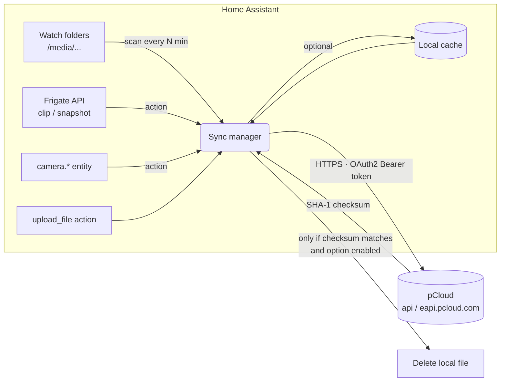

<div align="center">

# ☁️ pCloud Sync (Unofficial)

**Upload Home Assistant data – Frigate clips, camera snapshots, exports, any file – straight into your pCloud drive.**

[](https://my.home-assistant.io/redirect/marketplace_repository/?owner=DASO203&repository=pcloud-sync-unofficial&category=integration)
[](https://github.com/DASO203/pcloud-sync-unofficial/releases)
[](https://github.com/DASO203/pcloud-sync-unofficial/actions/workflows/validate.yml)
[](LICENSE)

🇬🇧 English · [🇩🇪 Deutsch](README.de.md)

</div>

> [!IMPORTANT]
> This is a **community project**. It is not affiliated with, endorsed by or supported by pCloud AG.
> "pCloud" is a trademark of its respective owner.

---

## Contents

- [Features](#features)
- [How it works](#how-it-works)
- [Requirements](#requirements)
- [Installation](#installation)
- [Setup](#setup)
- [Options](#options)
- [Data sources & examples](#data-sources--examples)
- [Actions (services)](#actions-services)
- [Entities](#entities)
- [Events](#events)
- [Security & transparency](#security--transparency)
- [Troubleshooting](#troubleshooting)
- [Uninstall](#uninstall)
- [Credits & license](#credits--license)

## Features

| | |
|---|---|
| 📁 **Folder sync** | Watches local folders (e.g. `/media/frigate/clips`) and uploads new or changed files on a schedule. Sub folders are mirrored. |
| 🎥 **Frigate** | Action that downloads the clip and/or snapshot of a Frigate event from the Frigate API and uploads it – ideal in an automation on `frigate/events`. |
| 📸 **Camera snapshots** | Action that takes a snapshot of any `camera.*` entity and uploads it. Works with every camera integration. |
| 📄 **Any file** | Action to upload a single file, e.g. an export written by another integration. |
| 💾 **Optional local cache** | Data that is not a file yet (snapshots, clips) can be written to disk first: no RAM spikes for large clips, automatic retry after network or pCloud outages. |
| 🗑️ **Optional delete after upload** | Local files can be deleted after the upload – **only** when pCloud confirms a matching SHA-1 checksum. |
| 🧪 **Dry run** | Shows in the log exactly what would be uploaded and deleted, without doing it. |
| 🔍 **Transparent** | Activity log, events for every action, sensors for status, counters and storage, redacted diagnostics. |
| 🔐 **Secure** | OAuth2 with **your own** pCloud app, no password stored, no third-party server, only allowed folders, symlinks are never followed. |
| 🌍 **EU & US** | The data region of your account is detected automatically. |
| 🇩🇪 🇬🇧 | Fully translated (German / English). |

## How it works



1. A sync run scans every watch folder (blocking work runs in an executor, symlinks are skipped).
2. Files that are new or changed since the last run, match the patterns and are older than the *minimum file age* are queued.
3. Each file is streamed to pCloud (`uploadfile` with `nopartial=1` – a broken transfer never leaves a half file).
4. The SHA-1 checksum returned by pCloud is compared with the local SHA-1.
5. Only if you enabled *Delete local files after upload*, the checksum matches **and** the file did not change during the upload, the local file is deleted.
6. The result is written to the log, the activity log, the sensors and fired as an event.

Uploaded files are remembered (path, size, modification time) in `.storage/pcloud_sync.state.<entry_id>`, so nothing is uploaded twice.

## Requirements

- Home Assistant **2025.1** or newer
- A pCloud account (free or premium, EU or US region)
- Network access from Home Assistant to `api.pcloud.com` / `eapi.pcloud.com`
- For OAuth: the [My Home Assistant](https://my.home-assistant.io/) redirect (enabled by default via `default_config`)

## Installation

### Home Assistant Marketplace (2026.11 and newer – recommended)

[](https://my.home-assistant.io/redirect/marketplace_repository/?owner=DASO203&repository=pcloud-sync-unofficial&category=integration)

Click the button above, or manually:

1. **Settings → Marketplace** → upper right **Add from link**
2. Enter `DASO203/pcloud-sync-unofficial` (type **Integration**)
   – the Marketplace asks once to connect to GitHub for repositories added by link
3. Open **pCloud Sync (Unofficial)** → **Download**
4. Continue with [Setup](#setup). A restart is only needed after updates.

> Once the integration is listed in the default catalog, you can simply search for **pCloud Sync** in the Marketplace.

### HACS (Home Assistant 2026.10 and older)

1. HACS → ⋮ → **Custom repositories**
2. Repository: `https://github.com/DASO203/pcloud-sync-unofficial`, type **Integration**
3. Search for **pCloud Sync (Unofficial)** → **Download**
4. Restart Home Assistant

### Manual

1. Download the latest [release](https://github.com/DASO203/pcloud-sync-unofficial/releases)
2. Copy `custom_components/pcloud_sync` to `<config>/custom_components/pcloud_sync`
3. Restart Home Assistant

## Setup

### 1. Create your own pCloud app

The integration deliberately ships **no** shared client id/secret. You create your own app, so only you control which app has access to your pCloud account.

1. Sign in at **<https://docs.pcloud.com/my_apps/>** → **New app**
2. Name: e.g. `Home Assistant`
3. **Redirect URI**: `https://my.home-assistant.io/redirect/oauth`
4. Permissions: the app needs access to **your files** (read/write)
5. Note **Client ID** and **Client secret**

### 2. Add the integration

1. **Settings → Devices & services → Add integration → pCloud Sync (Unofficial)**
2. Home Assistant asks for application credentials – enter the *Client ID* and *Client secret* from step 1
3. You are redirected to pCloud – sign in and allow access
4. Choose the **target folder** in pCloud (default `/HomeAssistant/Sync`)

> [!TIP]
> Credentials can be managed later under **Settings → Devices & services → ⋮ → Application credentials**.

### 3. Configure what is synced

Open **Configure** on the integration. Nothing is synced until you add a watch folder or call an action.

Start with **Dry run** enabled and check the log – then disable it.

## Options

| Option | Default | Description |
|---|---|---|
| **pCloud target folder** | `/HomeAssistant/Sync` | Root folder in pCloud. Everything is uploaded below it. |
| **Watch folders** | – | One local folder per line. Optional mapping: `/media/frigate/clips -> frigate/clips`. Without mapping the folder name is used. |
| **Include patterns** | `*` | Comma separated glob patterns, matched against file name and relative path, e.g. `*.mp4, *.jpg`. |
| **Exclude patterns** | `*.tmp, *.part, .*` | Also matches folder names, e.g. `cache` or `.*` (hidden). |
| **Sync interval** | 15 min | `0` = only via button / `pcloud_sync.sync_now`. |
| **Minimum file age** | 60 s | Skip files that changed recently (still being written). |
| **Delete local files after upload** | off | Deletes only after a checksum-verified upload. See [Security](#security--transparency). |
| **Date folders for action uploads** | on | Snapshots, Frigate events and `upload_file` go to `…/YYYY/MM/DD/`. |
| **If the file already exists** | Rename | *Rename* keeps both (`file (1).jpg`), *Overwrite* creates a new pCloud revision. |
| **Dry run** | off | Log only, nothing is uploaded or deleted. |
| **Use local cache** | off | See [Local cache](#local-cache). |
| **Cache folder** | `<config>/pcloud_sync_cache` | Must be inside the config folder or an allowed folder, must not overlap a watch folder. |
| **Frigate URL** | – | e.g. `http://ccab4aaf-frigate:5000` (Frigate add-on) or `http://<ip>:5000`. |
| **Max. files per sync** | 200 | Remaining files follow in the next run. |
| **Parallel uploads** | 2 | 1–4. |
| **Upload timeout** | 60 min | Per file. |

### Allowed folders

Home Assistant only lets integrations read folders that are allowed. `/media` (and the `www` folder inside the config folder) are allowed by default. Anything else must be added to `configuration.yaml`:

```yaml
homeassistant:
  allowlist_external_dirs:
    - /share/exports
```

### Local cache

| | Cache **off** (default) | Cache **on** |
|---|---|---|
| Camera snapshot / Frigate media | uploaded directly from memory | written to the cache folder first, then uploaded |
| Large clips | max. 200 MB (held in RAM) | streamed to disk, no size limit |
| pCloud / internet down | upload fails, event `pcloud_sync_upload_failed` | file stays in the cache and is retried on every sync |
| Cleanup | – | cached file is always deleted after a **verified** upload |

Watch folders do not need the cache – their files are already on disk and are streamed directly.

> [!NOTE]
> A cache inside `/config` is included in Home Assistant backups. If that is not wanted, use e.g. `/media/pcloud_sync_cache` (and do not add it as a watch folder).

## Data sources & examples

More ready-to-use automations: [`docs/examples/automations.yaml`](docs/examples/automations.yaml).

### Frigate – upload every event (recommended)

Uses the Frigate MQTT events (requires MQTT, which Frigate needs anyway):

```yaml
alias: "Frigate event → pCloud"
mode: queued
max: 20
triggers:
  - trigger: mqtt
    topic: frigate/events
conditions:
  - condition: template
    value_template: >
      {{ trigger.payload_json.type == 'end'
         and trigger.payload_json.after.has_clip }}
actions:
  - action: pcloud_sync.upload_frigate_event
    data:
      event_id: "{{ trigger.payload_json.after.id }}"
      camera_name: "{{ trigger.payload_json.after.camera }}"
      media: both
```

Result in pCloud: `/HomeAssistant/Sync/frigate/<camera>/2026/11/25/<camera>_<event_id>.mp4` (+ `.jpg`).

### Frigate – sync folders

Frigate (add-on) stores its media in `/media/frigate`:

```
/media/frigate/clips -> frigate/clips
/media/frigate/exports -> frigate/exports
```

> [!WARNING]
> Do **not** enable *Delete local files after upload* for folders that Frigate manages itself (`recordings`, `clips`). Frigate keeps a database of these files and handles retention on its own. Deleting is safe for folders you own, e.g. exports or snapshot folders written by your automations.

### Camera snapshot on motion / doorbell

```yaml
triggers:
  - trigger: state
    entity_id: binary_sensor.doorbell
    to: "on"
actions:
  - action: pcloud_sync.upload_camera_snapshot
    data:
      entity_id: camera.front_door
```

### Files from other integrations

Many integrations write files (e.g. `camera.snapshot`, `camera.record`, exports, reports). Let them write into a watch folder – or upload directly:

```yaml
actions:
  - action: camera.snapshot
    target:
      entity_id: camera.garage
    data:
      filename: /media/snapshots/garage.jpg
  - action: pcloud_sync.upload_file
    data:
      path: /media/snapshots/garage.jpg
      subfolder: garage
      delete_after_upload: true
```

## Actions (services)

All actions return a response (use `response_variable`) and accept an optional `config_entry_id` if several pCloud accounts are configured.

| Action | Fields | Description |
|---|---|---|
| `pcloud_sync.sync_now` | – | Scan watch folders (and cache) now. |
| `pcloud_sync.upload_file` | `path`, `subfolder`, `delete_after_upload` | Upload one local file (must be in an allowed folder). |
| `pcloud_sync.upload_camera_snapshot` | `entity_id`, `subfolder`, `filename` | Snapshot of one or more cameras. |
| `pcloud_sync.upload_frigate_event` | `event_id`, `media` (`clip`/`snapshot`/`both`), `camera_name`, `subfolder`, `frigate_url`, `retries` | Download from Frigate and upload. Retries every 10 s while Frigate is still creating the clip. |
| `pcloud_sync.list_folder` | `path`, `recursive` | **Read back:** list files below the target folder. *Administrators only.* |
| `pcloud_sync.get_file_link` | `path` | **Read back:** temporary download link of a file below the target folder. *Administrators only.* |

The two read-back actions can only see the pCloud target folder of this integration (paths outside are mapped into it, `..` is rejected). [Alcedo NVR](https://github.com/DASO203/alcedo-nvr-integration) uses them to show archived alarms in its timeline after the local copies were deleted.

Example response of `upload_file`:

```yaml
source: upload_file
local_path: /media/snapshots/garage.jpg
remote_path: /HomeAssistant/Sync/garage/2026/11/25/garage.jpg
file_id: 123456789
size: 182345
verified: true
deleted_local: true
```

## Entities

| Entity | Description |
|---|---|
| `sensor.<name>_status` | `idle`, `syncing`, `error`, `auth_error`. Attributes: last error, active options, watch folders, the 10 most recent actions. |
| `sensor.<name>_last_sync` | Time of the last sync run. |
| `sensor.<name>_pending_files` | Files still waiting for upload. |
| `sensor.<name>_uploaded_files` / `_uploaded_data` | Totals (persisted). |
| `sensor.<name>_deleted_local_files` / `_failed_uploads` | Diagnostics counters. |
| `sensor.<name>_storage_used` / `_storage_free` / `_storage_total` | pCloud quota (updated every 30 min, *total* disabled by default). |
| `button.<name>_sync_now` | Start a sync. |

## Events

| Event | Data |
|---|---|
| `pcloud_sync_file_uploaded` | `entry_id`, `source`, `local_path`, `remote_path`, `file_id`, `size`, `verified` |
| `pcloud_sync_upload_failed` | `entry_id`, `source`, `name`, `error` |
| `pcloud_sync_local_file_deleted` | `entry_id`, `source`, `local_path` |

Example – notify on failures:

```yaml
triggers:
  - trigger: event
    event_type: pcloud_sync_upload_failed
actions:
  - action: notify.notify
    data:
      message: "pCloud upload failed: {{ trigger.event.data.name }} – {{ trigger.event.data.error }}"
```

## Security & transparency

**Authentication**
- OAuth2 with *your own* pCloud app. Your pCloud password is never seen or stored by Home Assistant.
- The access token is stored by Home Assistant in `.storage/core.config_entries` (like every OAuth integration) and is only sent as `Authorization: Bearer` header over HTTPS to `api.pcloud.com` / `eapi.pcloud.com`. It never appears in URLs or logs.
- You can revoke access any time in pCloud (*Settings → Apps*). The integration then asks for re-authentication.

**Data flow**
- Data goes **directly** from Home Assistant to pCloud. There is no server in between, no telemetry, no analytics.
- Frigate media is fetched only from the Frigate URL you configure.

**File system**
- Only folders allowed by Home Assistant (`allowlist_external_dirs` / media dirs) are read; this is checked when saving the options and on every run.
- Symlinks are never followed – a sync cannot leave the configured folder.
- Remote paths are sanitized; `..` is rejected.

**Deleting local data – only if all conditions are met**
1. You enabled *Delete local files after upload* (or `delete_after_upload: true` in the action),
2. the upload succeeded,
3. pCloud's SHA-1 checksum equals the local SHA-1,
4. size and modification time did not change during the upload,
5. dry run is off.

Otherwise the file is kept and an entry `kept_local` with the reason is written to the activity log. Remote files are **never** deleted by this integration.

**Transparency**
- Every upload / deletion / failure is logged (`INFO` / `WARNING`), fired as event and listed in the activity log (`sensor.<name>_status` → `recent_activity`, full log of 50 entries in diagnostics).
- **Download diagnostics** (integration page → ⋮) gives you options, state and activity log with tokens and personal data redacted.
- Verbose logging:

  ```yaml
  logger:
    logs:
      custom_components.pcloud_sync: debug
  ```

Found a security problem? See [SECURITY.md](SECURITY.md).

## Troubleshooting

| Problem | Solution |
|---|---|
| *Error while obtaining the access token* | Check client id/secret and that the redirect URI of your pCloud app is exactly `https://my.home-assistant.io/redirect/oauth`. |
| *Home Assistant does not allow access to …* | Add the folder to `allowlist_external_dirs`. |
| Files are not uploaded | Check patterns and *minimum file age*; enable dry run and look at the log. |
| Frigate: `HTTP 404` | The clip is not ready yet – increase `retries`, or the event has no clip (`has_clip: false`). |
| Frigate: connection refused | Check the URL/port. The add-on hostname is shown on the add-on page; port 5000 is the internal, unauthenticated API. |
| Download exceeds 200 MB | Enable the local cache. |
| Status `auth_error` | Token was revoked – follow the re-authentication notification. |

## Uninstall

1. **Settings → Devices & services → pCloud Sync → ⋮ → Delete**
2. Optional: remove the application credentials and revoke the app in pCloud
3. Remove it in the Marketplace (or HACS / delete `custom_components/pcloud_sync`) and restart
4. Optional: delete the cache folder

Files already uploaded to pCloud are not touched.

## Credits & license

- pCloud API usage (OAuth2, region handling) was inspired by [ghotso/HAS-pCloud-Backup](https://github.com/ghotso/HAS-pCloud-Backup).
- [pCloud API documentation](https://docs.pcloud.com/)

Released under the [MIT License](LICENSE). Contributions welcome – see [CONTRIBUTING.md](CONTRIBUTING.md).
